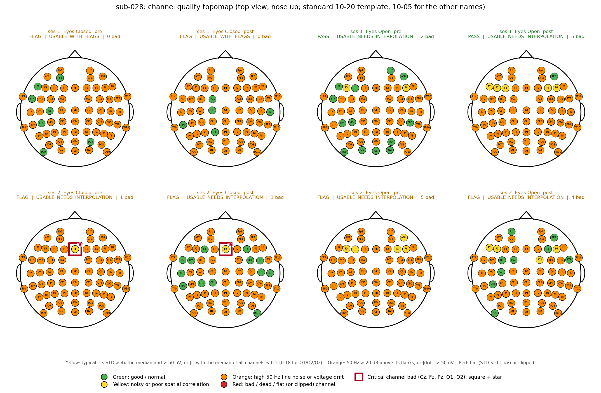
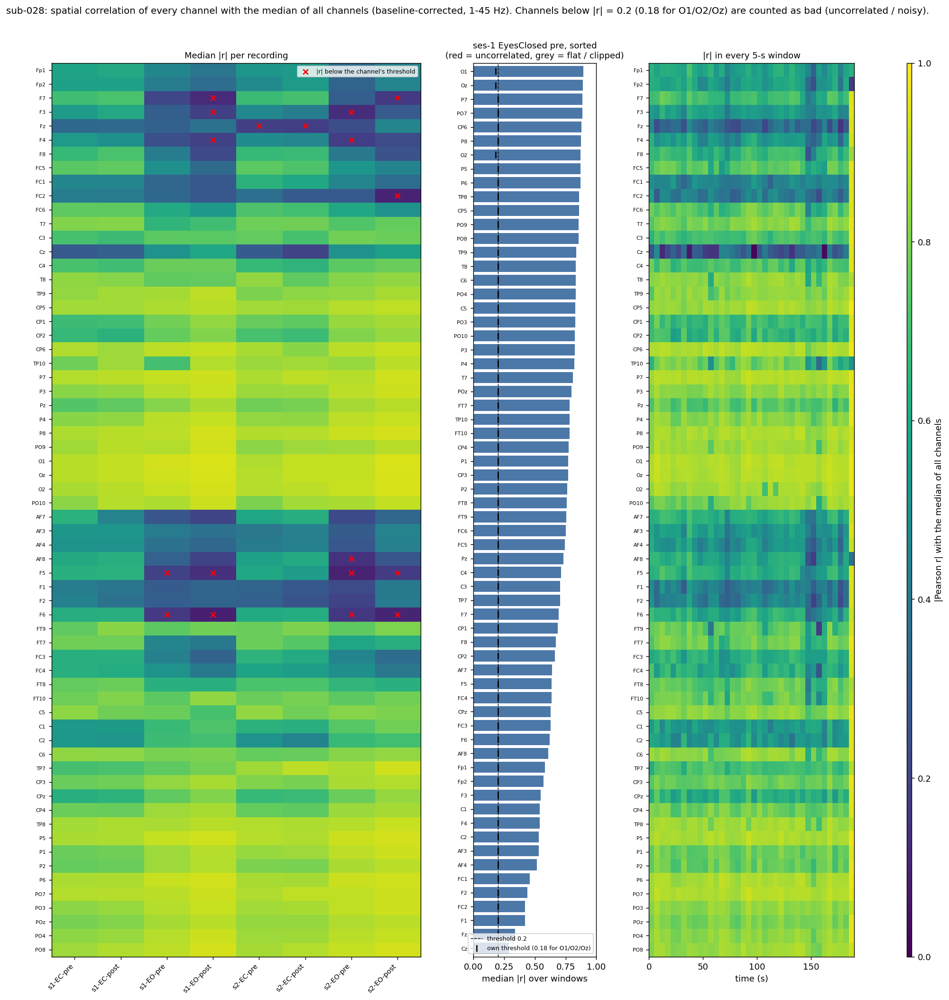
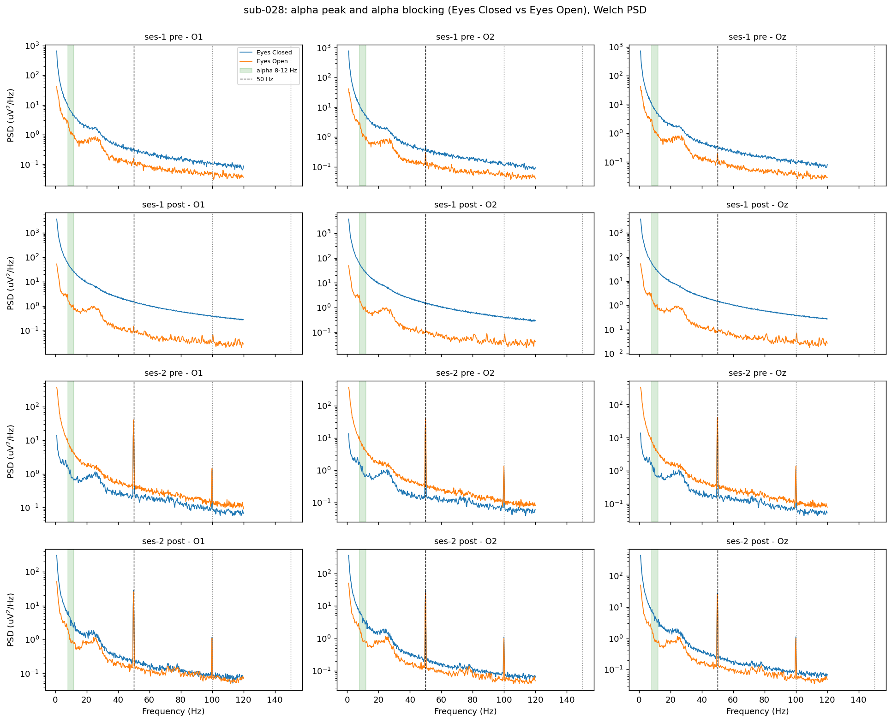
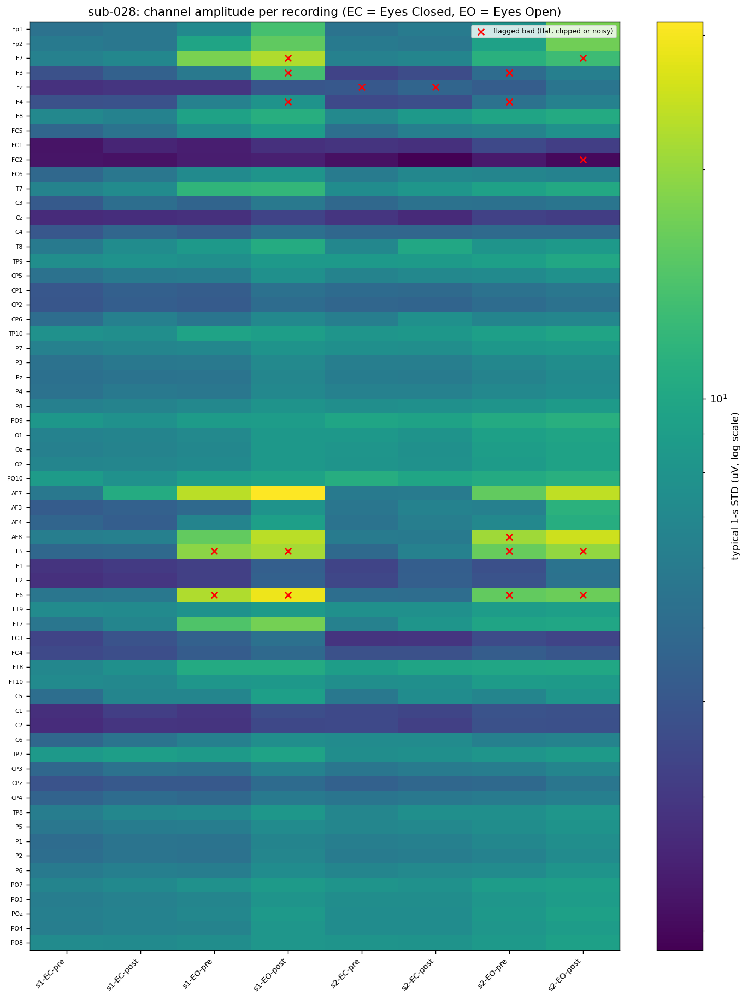
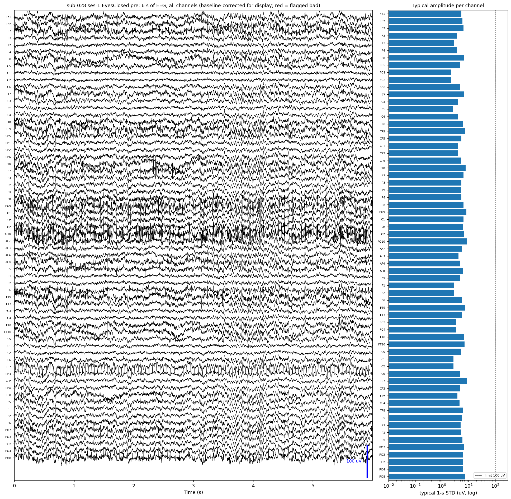
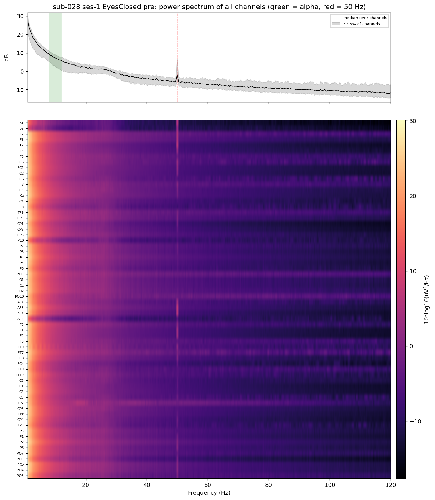
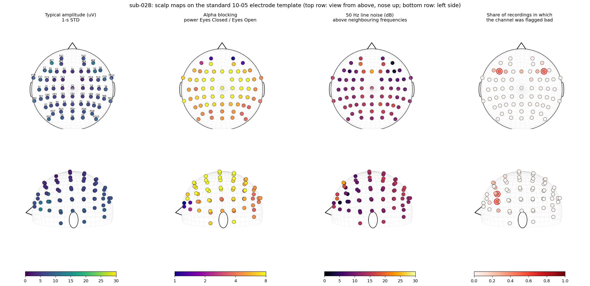
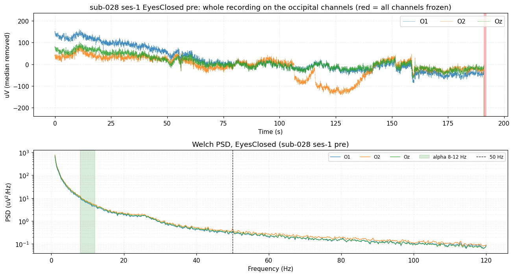

# 🔍 Output guide: every file and figure explained

The examples [`sub-028`](../examples/sub-028/README.md) and [`sub-053`](../examples/sub-053/README.md) contain the **unmodified output** of `python qc_eeg_subject.py 28` and `python qc_eeg_subject.py 53` ([OpenNeuro ds005385 v1.0.3](https://openneuro.org/datasets/ds005385/versions/1.0.3), both sessions, eight recordings each). A subject with only session 1 (four recordings, 11 figures) is shown in [`sub-325`](../examples/sub-325/README.md). This guide explains every file the script writes for one subject, using `sub-028` as the example. The project description is in the [root README](../README.md).

**Contents**

1. [Folder map](#1-folder-map)
2. [Read this first: `status.txt`](#2-read-this-first-statustxt)
3. [The tables](#3-the-tables)
4. [The figures](#4-the-figures)
5. [Reproducibility files](#5-reproducibility-files)
6. [How to read a subject in two minutes](#6-how-to-read-a-subject-in-two-minutes)

---

## 1. Folder map

```text
sub-028/
├── status.txt                  ← the whole story of the subject in plain text
├── status.json                 ← the same, machine-readable
└── qc_results/
    ├── df_recordings.csv       ← one row per recording
    ├── df_recordings_full.csv  ← every metric of every layer
    ├── df_subjects.csv         ← one row for the subject
    ├── df_channels.csv         ← one row per channel and recording
    ├── qc_issues.csv           ← every finding (FAIL / FLAG / MISSING) and PASS note
    ├── qc_signoff.csv          ← sheet for the human reviewer
    ├── qc_pivot.csv            ← verdict per recording in one row
    ├── qc_report.txt           ← readable report
    ├── run_manifest.json       ← everything needed to reproduce the run
    ├── run_log.txt             ← the terminal text of this subject
    └── figures/                ← 15 figures
```

The eight recordings of this subject are `ses-1` and `ses-2`, each with **Eyes Closed (EC) / Eyes Open (EO) × pre / post**.

## 2. Read this first: `status.txt`

[`status.txt`](../examples/sub-028/status.txt) tells the whole story in one page. (`status.json` has the same content for programs.) Its sections:

| Section | What it tells you |
|---|---|
| **Header** | status (`COMPLETED`), **QC verdict** (PASS / FLAG / FAIL), **screening label**, a one-line summary, start and finish time, duration, participant, QC logic version |
| **ELIGIBILITY** | the rules that decide whether a subject is analysed at all (age at most 60, session 1 completed, no late triggers, session 2 optional), each with `PASS` / `FAIL` / `INFO` and the value |
| **DATA** | download method, dataset tag and commit, files downloaded / already on disk / not in the dataset / failed, result of the comparison with the dataset's `participants.tsv` |
| **QC RESULT** | counts of PASS / FLAG / FAIL / MISSING and of the labels, a table with one line per recording, the **reason codes** of every recording, key findings and the **"Needs attention"** list |
| **CLEAN-UP** | how many data files were deleted and how many MB were freed |
| **FILES** | every file that was written |
| **WARNINGS / ERROR** | only present if something needs attention |

The two words that matter most:

| Word | Possible values |
|---|---|
| **Verdict** (worst of all recordings) | `PASS` nothing to note · `FLAG` small problem, kept · `FAIL` clear problem · `MISSING` file not available |
| **Label** | `USABLE` · `USABLE_WITH_FLAGS` · `USABLE_NEEDS_INTERPOLATION` · `REJECT`; for a subject also `PARTIALLY_USABLE` (some recordings usable, others rejected) |

## 3. The tables

All tables are in `qc_results/`.

### `df_recordings.csv` — one row per recording

The most useful table. Main columns:

| Column | Meaning |
|---|---|
| `session`, `task`, `acq` | which recording (`EyesClosed` / `EyesOpen`, `pre` / `post`) |
| `overall`, `label`, `codes` | verdict, screening label and all reason codes |
| `verdict_header` … `verdict_consistency` | verdict of each of the five layers |
| `n_bad_channels`, `bad_channels`, `bad_detail` | bad channels and why (`F3 (noisy+uncorrelated)`) |
| `n_critical_bad`, `critical_bad_channels` | bad channels among Cz, Fz, Pz, O1, O2 |
| `n_uncorrelated`, `uncorrelated_channels`, `median_spatial_corr` | spatial-correlation result |
| `interpolation_needed` | `True` if 1–6 bad channels can be interpolated |
| `typical_amp_uv`, `median_kurtosis` | typical amplitude (µV) and kurtosis on the baseline-corrected signal |
| `alpha_peak_hz`, `alpha_prom_db`, `alpha_ratio_EC_EO` | alpha peak frequency, how much it stands out (dB), Eyes Closed / Eyes Open alpha power |
| `alpha_non_responder_possible` | weak alpha peak and weak alpha blocking together (only a flag) |
| `line50_db`, `line100_db`, `line150_db`, `notch_suggested` | line noise in dB above its neighbouring frequencies |
| `frozen_s`, `trigger_events`, `load_error` | frozen time, number of trigger events, read error if any |

### `df_recordings_full.csv`
Every metric of every layer (hundreds of columns, prefixed `hdr_`, `int_`, `amp_`, `spec_`, `con_`, plus `info_` for trigger information). Use it when you need a number that is not in the short table.

### `df_channels.csv` — one row per channel and recording
All per-channel statistics and flags:

| Group | Columns |
|---|---|
| Amplitude (baseline-corrected) | `std_uv`, `window_std_uv`, `variance_uv2`, `skewness`, `kurtosis`, `p_low_uv`, `p_high_uv`, `range_p_uv`, `ptp_uv` |
| Raw-signal checks | `std_clean_uv`, `clip_frac`, `longest_equal_run_s`, `median_uv` (DC offset), `drift_uv` |
| Spatial correlation | `corr_median`, `corr_low_frac`, `corr_threshold_used`, `corr_below_thr`, `corr_ref_unreliable` |
| Spectrum | `alpha_power_uv2`, `alpha_prominence_db`, `line50_db` |
| Flags | `flat`, `clipped`, `noisy`, `uncorrelated`, **`bad`**, `is_critical`, `dc_offset_info`, `drift_info` |

### `qc_issues.csv`
Every finding with `verdict`, reason `code`, the measured `value` and the `limit` it was compared with, worst first. PASS notes such as `USABLE_NEEDS_INTERPOLATION` are included.

### `df_subjects.csv`, `qc_pivot.csv`, `qc_signoff.csv`
`df_subjects.csv` is the one-row summary of the subject. `qc_pivot.csv` shows the verdict of all recordings in one row. `qc_signoff.csv` is a sheet for a human reviewer: it contains the suggested decision (for example *accept (interpolate the bad channels in preprocessing)*) and an empty column for the reviewer's own decision.

### `qc_report.txt`
A readable report: screening decision, key findings, verdict and reason codes per recording, all findings and the sign-off line.

## 4. The figures

All figures are in `qc_results/figures/`. File names contain the subject ID.

### 4.1 Channel Quality Topomap

`sub-028_task-rest_channel_quality_topomap.png`



**What it shows.** One head (top view, nose up) for each recording: rows are sessions, columns are *Eyes Closed pre, Eyes Closed post, Eyes Open pre, Eyes Open post*. Every channel is a dot with its name. The title of each head gives the verdict, the label and the number of bad channels.

| Colour | Meaning |
|---|---|
| 🟢 green | good / normal |
| 🟡 yellow | noisy (typical 1-s STD more than 4 × the median and above 50 µV) or poor spatial correlation |
| 🟠 orange | high 50 Hz line noise (above 20 dB) or voltage drift (above 50 µV) |
| 🔴 red | bad / dead / flat (or clipped) |

A **critical channel** (Cz, Fz, Pz, O1, O2) that is bad gets a **thick red square and a star**. Critical channels are always written in bold.

**How to use it.** The fastest overview of a subject: one glance shows whether bad channels sit in one region, whether they are the same in every recording (a broken electrode) or change from recording to recording, and whether a critical channel is affected. Electrode positions come from MNE's standard template.

### 4.2 Spatial correlation

`G_spatial_correlation_sub-028.png`



**What it shows.** How strongly every channel is correlated with the median of all channels (|Pearson r|, band 1–45 Hz, windows of 5 s, baseline-corrected signal).

* **Left:** median |r| of every channel in every recording. Red crosses mark channels below their threshold (0.20; 0.18 for O1, O2, Oz).
* **Middle:** the same for the representative recording (`ses-1`, Eyes Closed, pre), sorted from lowest to highest. Red bars = *uncorrelated* channels, grey bars = flat or clipped channels (they are excluded from this rule), dashed line = the general threshold, small black ticks = each channel's own threshold.
* **Right:** |r| in each 5-second window over time. A channel that is bad only for part of the recording appears as a dark patch instead of a full stripe.

**How to read it.** Healthy channels are bright (yellow-green). A uniformly dark stripe is a channel that is unrelated to all others (typically a loose or noisy electrode). Occipital channels are often a little darker because strong local alpha lowers their correlation; this is why their threshold is more tolerant.

### 4.3 Occipital spectrum — alpha and line noise

`A_psd_occipital_sub-028.png`



**What it shows.** Welch power spectrum (µV²/Hz, log scale, 1–120 Hz) of O1, O2 and Oz. Rows are session and pre/post, columns are the channels. **Blue = Eyes Closed, orange = Eyes Open.** The green band is alpha (8–12 Hz), the dashed vertical line is 50 Hz, dotted lines are 100 and 150 Hz.

**How to read it.** In a typical healthy subject the blue curve rises above the orange one in the green band (alpha peak and *alpha blocking*). A sharp spike at 50 Hz is mains noise. A missing alpha peak is only a flag, because many healthy people do not show one.

### 4.4 Amplitude per channel and recording

`B_amplitude_heatmap_sub-028.png`



**What it shows.** The *typical amplitude* (median 1-second STD, µV, logarithmic colour scale) of every channel (rows) in every recording (columns, for example `s1-EC-pre`). A **red cross** marks a channel flagged as bad.

**How to read it.** A row that is clearly brighter or darker than its neighbours in all columns is a persistently abnormal channel. A column that is different as a whole is an abnormal recording.

### 4.5 Six seconds of raw-looking signal

`C_traces_sub-028.png`



**What it shows.** Left: six seconds from the middle of the representative recording (`ses-1`, Eyes Closed, pre), all channels stacked, with the slow baseline removed for display. **Red traces are channels flagged bad.** The blue bar is a 100 µV scale. Right: the typical amplitude of each channel on a log axis, with the 100 µV limit as a dashed line.

**How to read it.** This is the "look at the EEG" check in one image: a flat line, a very large or a different-looking trace stands out immediately.

### 4.6 Spectrum of all channels

`D_psd_all_channels_sub-028.png`



**What it shows.** Top: median spectrum over channels (black) with the 5–95 % range of channels (grey), in dB; green = alpha band, red dashed = 50 Hz. Bottom: the spectrum of **every channel** as an image (channels × frequency).

**How to read it.** A **bright or dark horizontal band** is a channel whose power differs from the others (bad channel). A **vertical stripe** at 50, 100, 150 Hz is line noise that affects all channels.

### 4.7 3D scalp maps

`E_scalp_3d_sub-028.png`



**What it shows.** Four scalp maps, each in a top view (nose up) and a left-side view, using the median over the recordings of the subject:

1. typical **amplitude** (µV),
2. **alpha blocking**: alpha power Eyes Closed / Eyes Open (1 = no change, higher = stronger alpha with closed eyes),
3. **50 Hz line noise** (dB above the neighbouring frequencies),
4. **share of recordings in which the channel was flagged bad** (red rings: bad in at least half of them).

**How to read it.** Alpha blocking should be strongest at the back of the head. Line noise and amplitude problems that follow one region of the scalp often point to a cable or a ground/reference problem.

### 4.8 Whole recording, one figure per recording

`F_overview_sub-028_<session>_<task>_<acq>.png` (eight files, for example `F_overview_sub-028_ses-1_EyesClosed_pre.png`)



**What it shows.** Top: the **whole recording** on O1, O2 and Oz (median removed, drawn at a reduced sampling rate). **Red shaded areas** are moments when *all channels are frozen* at the same time (a recording dropout). Bottom: the spectrum of the three channels with the alpha band and 50 Hz marked.

**How to read it.** Slow waves are normal in a raw recording. Look for sudden jumps, long flat stretches or red shaded blocks.

The other seven recordings have the same layout:

| File | Recording |
|---|---|
| `F_overview_sub-028_ses-1_EyesClosed_pre.png` | session 1, Eyes Closed, pre |
| `F_overview_sub-028_ses-1_EyesClosed_post.png` | session 1, Eyes Closed, post |
| `F_overview_sub-028_ses-1_EyesOpen_pre.png` | session 1, Eyes Open, pre |
| `F_overview_sub-028_ses-1_EyesOpen_post.png` | session 1, Eyes Open, post |
| `F_overview_sub-028_ses-2_EyesClosed_pre.png` | session 2, Eyes Closed, pre |
| `F_overview_sub-028_ses-2_EyesClosed_post.png` | session 2, Eyes Closed, post |
| `F_overview_sub-028_ses-2_EyesOpen_pre.png` | session 2, Eyes Open, pre |
| `F_overview_sub-028_ses-2_EyesOpen_post.png` | session 2, Eyes Open, post |

## 5. Reproducibility files

* **`qc_results/run_manifest.json`** — the exact command line, versions of Python and all packages, dataset version and Git commit, the complete `CONFIG` (all thresholds), the SHA-256 and size of every input file, the participant row, the QC logic version and fingerprint, the verdict and the list of outputs.
* **`qc_results/run_log.txt`** — the text that was shown in the terminal while this subject was processed, without colours.

With the same script version, the same `CONFIG` and the same dataset version, the analysis gives the same results (there is no randomness).

## 6. How to read a subject in two minutes

1. Open **`status.txt`**: look at the verdict and the label, then the *Needs attention* list.
2. Open the **channel quality topomap**: are bad channels few, and are critical channels (square + star) affected?
3. Look at **`qc_issues.csv`**: the reason codes tell you what to do.

| Label | What to do |
|---|---|
| `USABLE` | use as it is |
| `USABLE_WITH_FLAGS` | use; check the flagged item (for example line noise: add a notch filter) |
| `USABLE_NEEDS_INTERPOLATION` | use after interpolating the bad channels listed in `bad_detail` |
| `PARTIALLY_USABLE` | keep the usable recordings, look at the rejected ones |
| `REJECT` | do not use; the reason code says why |

*Want the whole dataset at a glance? See the [Excel overview of all 608 subjects](../summary_all_subjects.xlsx).*
