# 🔍 sub-053: example output

The unmodified output of

```bash
python qc_eeg_subject.py 53
```

for `sub-053` of [OpenNeuro ds005385 v1.0.3](https://openneuro.org/datasets/ds005385/versions/1.0.3) (two sessions, eight recordings).
How to read each file: [output guide](../../docs/output-guide.md)  ·  back to the [main README](../../README.md)

## Result at a glance

| | |
|---|---|
| **QC verdict** | **FAIL** |
| **Subject label** | `PARTIALLY_USABLE` |
| Recordings PASS / FLAG / FAIL | 1 / 3 / 4 |
| Usable recordings | **4 of 8** |
| Time for this subject (incl. download) | 173.9 s |

> overall FAIL; PARTIALLY_USABLE: 4/8 recordings usable; bad channels in 8 recording(s) (FC1, FC3, F2); alpha blocking OK (median 6.1)

| Session | Task | Acq | Verdict | Label | Bad channels | Which | Alpha EC/EO | 50 Hz (dB) |
|---|---|---|---|---|---:|---|---:|---:|
| ses-1 | EyesClosed | pre | FLAG | `USABLE_NEEDS_INTERPOLATION` | 5 | Fz, F4, AF4, F1, F2 | 2.68 | 6.49 |
| ses-1 | EyesClosed | post | FAIL | `REJECT` | 9 | F3, Fz, FC5, FC1, C3, F1, F2, FC3, C5 | 8.02 | 5.47 |
| ses-1 | EyesOpen | pre | FAIL | `REJECT` | 7 | F8, FC5, FC1, FC2, F6, FC3, FC4 | 2.68 | 6.96 |
| ses-1 | EyesOpen | post | FAIL | `REJECT` | 7 | FC5, FC1, FC2, FC6, FC3, FC4, C5 | 8.02 | 8.21 |
| ses-2 | EyesClosed | pre | FLAG | `USABLE_NEEDS_INTERPOLATION` | 3 | Fz, F1, F2 | 12.12 | 2.18 |
| ses-2 | EyesClosed | post | FLAG | `USABLE_NEEDS_INTERPOLATION` | 2 | Fz, F2 | 4.1 | 4.19 |
| ses-2 | EyesOpen | pre | PASS | `USABLE_NEEDS_INTERPOLATION` | 1 | FC2 | 12.12 | 1.09 |
| ses-2 | EyesOpen | post | FAIL | `REJECT` | 7 | FC1, FC2, T7, T8, FC3, FC4, C5 | 4.1 | 3.68 |

## Folder structure

```text
sub-053/
├── README.md                          (this file)
├── status.txt                         summary of the whole subject
├── status.json                        the same, machine-readable
└── qc_results/
    ├── df_recordings.csv              one row per recording
    ├── df_recordings_full.csv         every metric of every layer
    ├── df_subjects.csv                one row for the subject
    ├── df_channels.csv                one row per channel and recording
    ├── qc_issues.csv                  every FAIL / FLAG / MISSING finding
    ├── qc_signoff.csv                 sheet for the human reviewer
    ├── qc_pivot.csv                   verdict per recording in one row
    ├── qc_report.txt                  readable report
    ├── run_manifest.json              everything needed to reproduce the run
    ├── run_log.txt                    terminal text of this subject
    └── figures/
        ├── sub-053_task-rest_channel_quality_topomap.png
        ├── G_spatial_correlation_sub-053.png
        ├── A_psd_occipital_sub-053.png
        ├── B_amplitude_heatmap_sub-053.png
        ├── C_traces_sub-053.png
        ├── D_psd_all_channels_sub-053.png
        ├── E_scalp_3d_sub-053.png
        └── F_overview_sub-053_<session>_<task>_<acq>.png    (8 files)
```

## Key files

| | |
|---|---|
| [`status.txt`](status.txt) | verdict, label, per-recording table, "needs attention" |
| [`qc_results/qc_report.txt`](qc_results/qc_report.txt) | readable report |
| [`qc_results/df_recordings.csv`](qc_results/df_recordings.csv) | one row per recording |
| [`qc_results/qc_issues.csv`](qc_results/qc_issues.csv) | all findings with reason codes |
| [`qc_results/df_channels.csv`](qc_results/df_channels.csv) | per-channel statistics and flags |
| [`qc_results/run_manifest.json`](qc_results/run_manifest.json) | reproducibility record |

## Figures

### Channel quality topomap
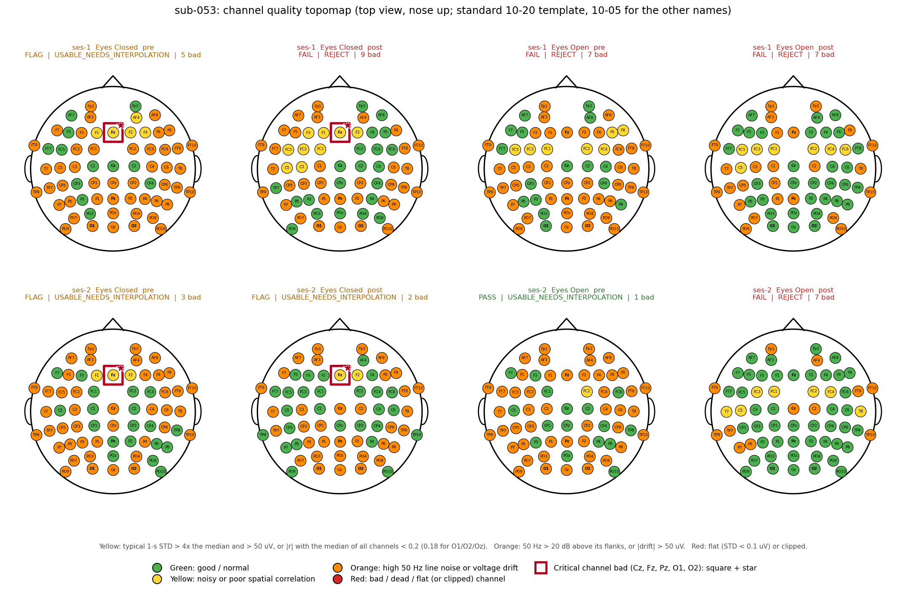

### Spatial correlation
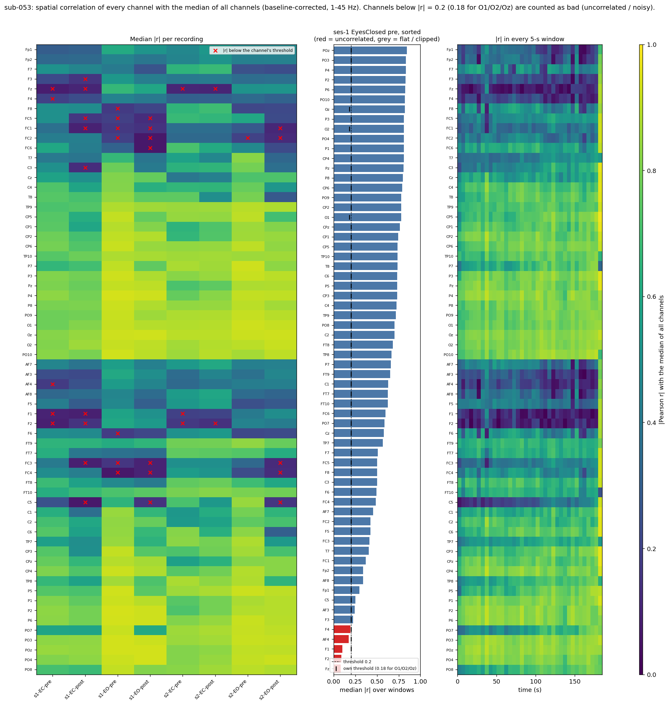

### Occipital spectrum (alpha and 50 Hz)
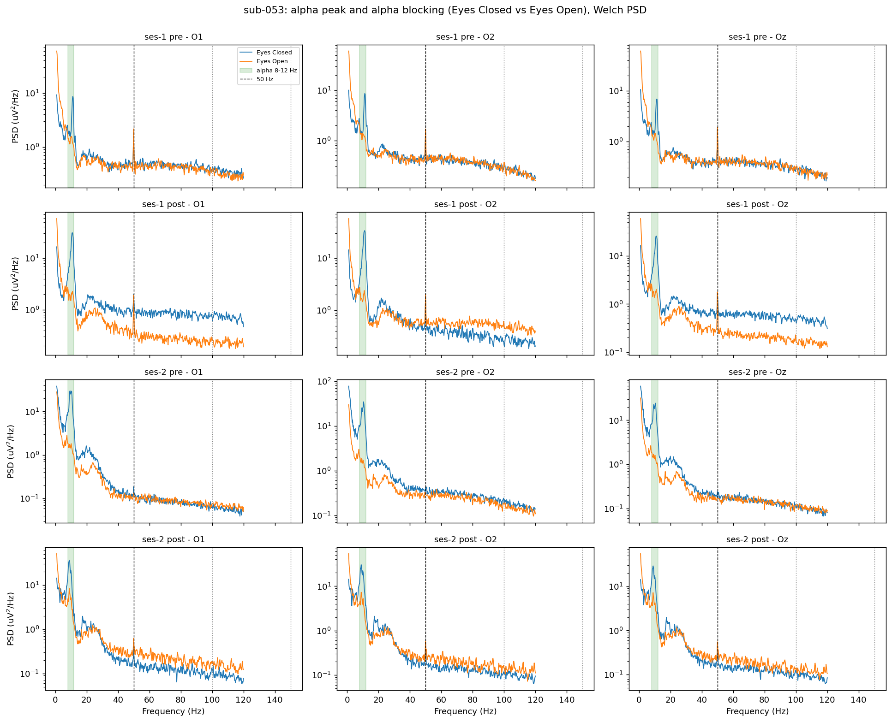

### Amplitude per channel and recording
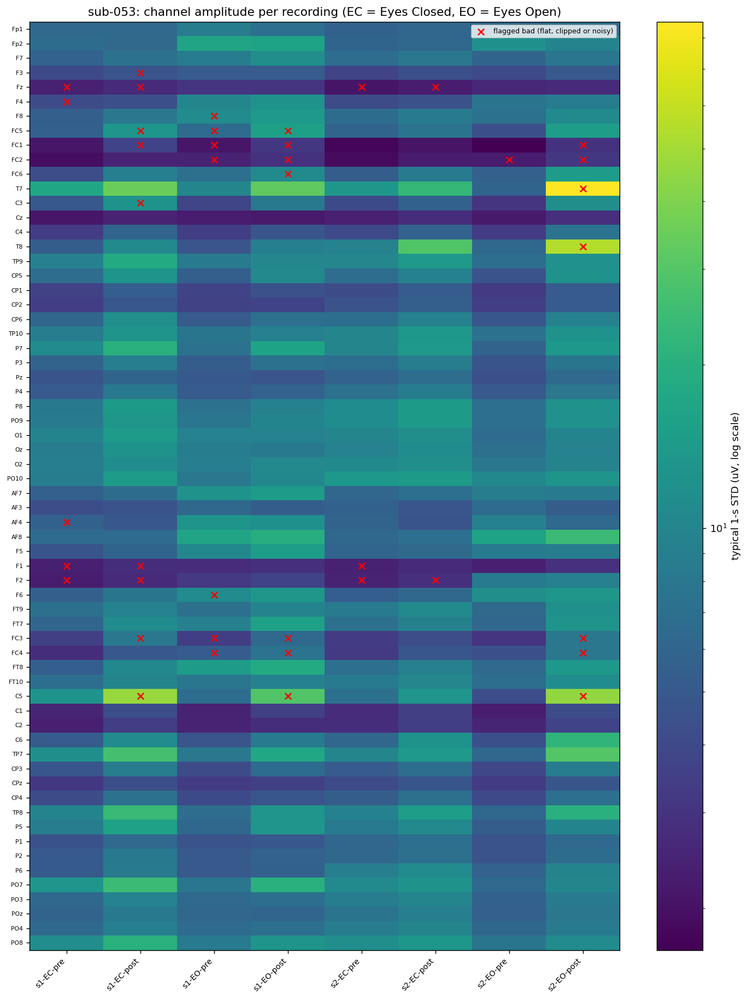

### Six seconds of EEG
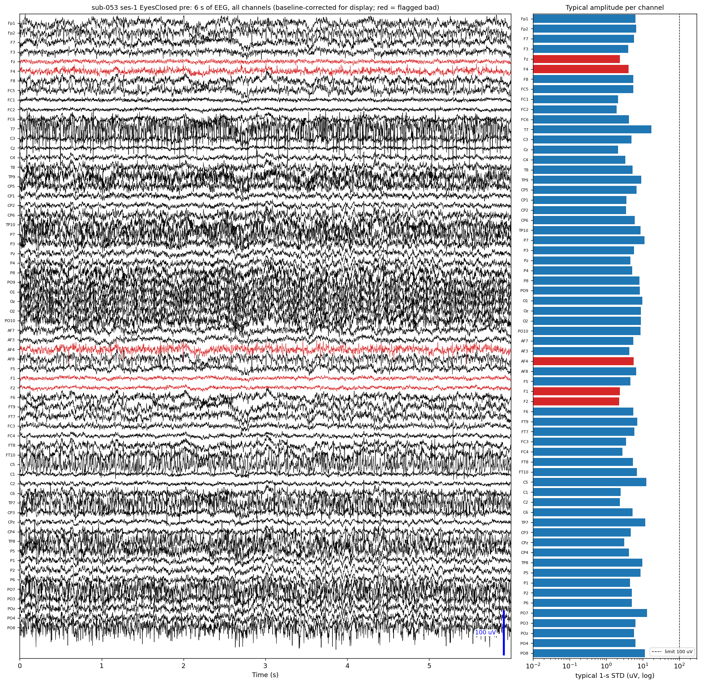

### Spectrum of all channels
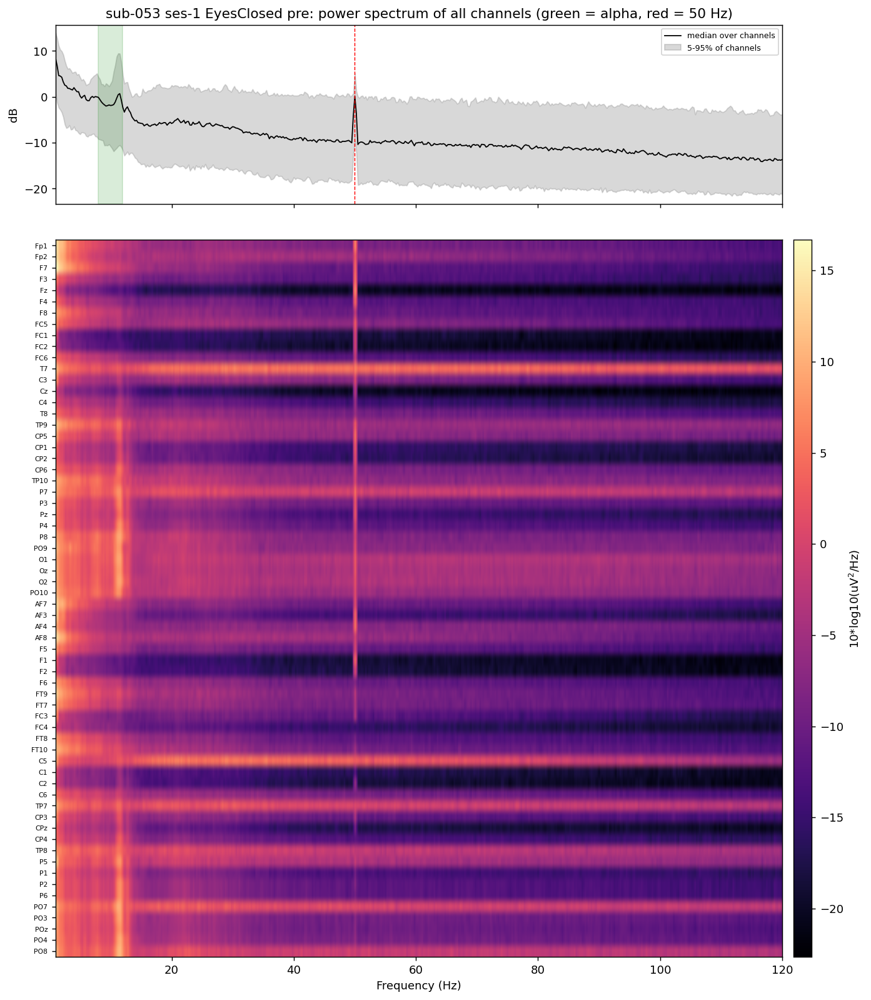

### 3D scalp maps
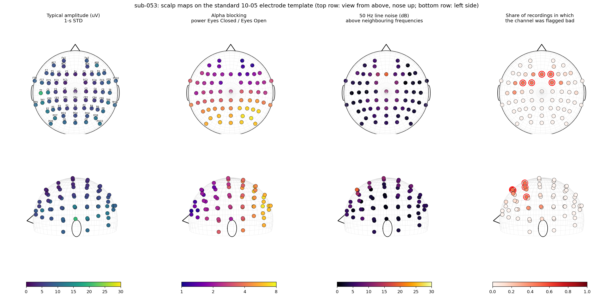

<details>
<summary><b>Whole-recording overviews (8 figures, one per recording)</b></summary>

**ses-1, Eyes Closed, pre**  
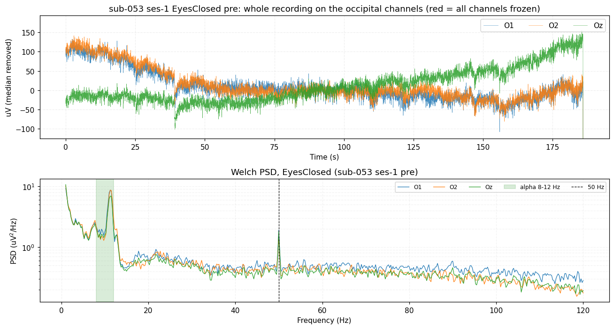

**ses-1, Eyes Closed, post**  
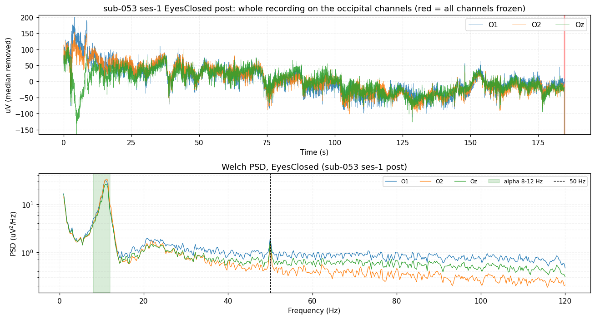

**ses-1, Eyes Open, pre**  
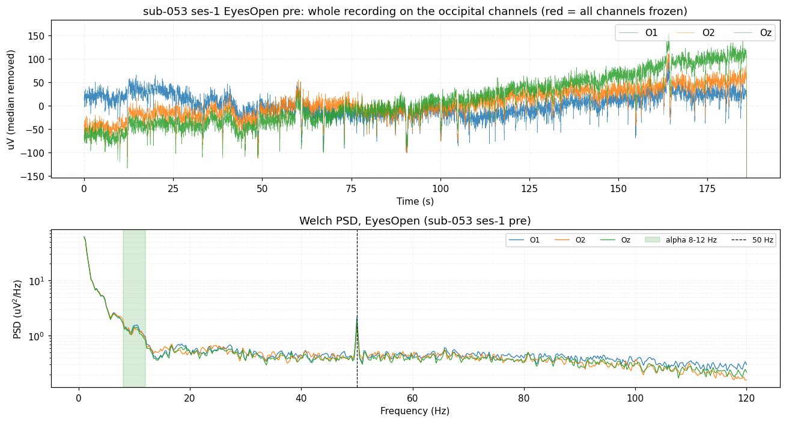

**ses-1, Eyes Open, post**  
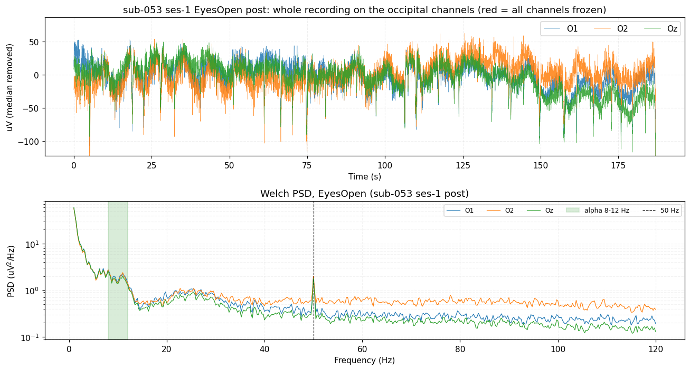

**ses-2, Eyes Closed, pre**  
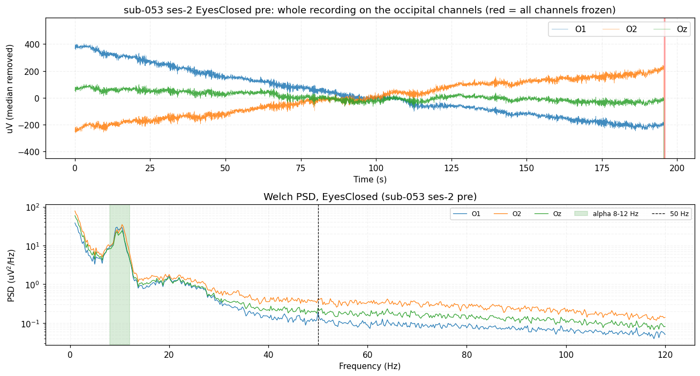

**ses-2, Eyes Closed, post**  
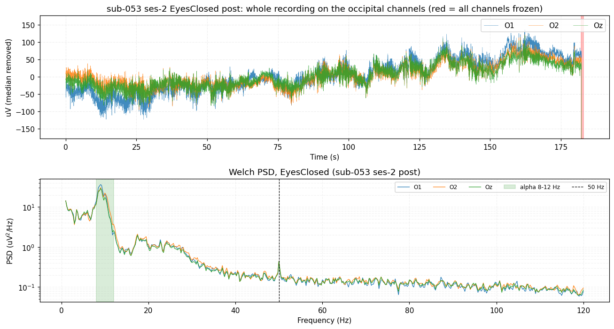

**ses-2, Eyes Open, pre**  
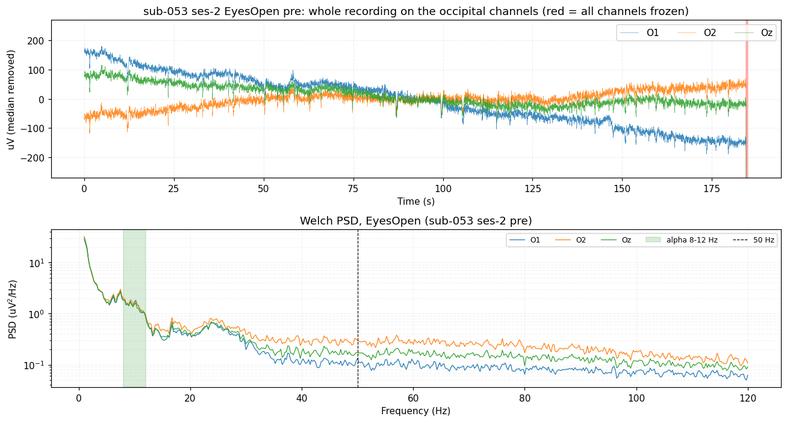

**ses-2, Eyes Open, post**  
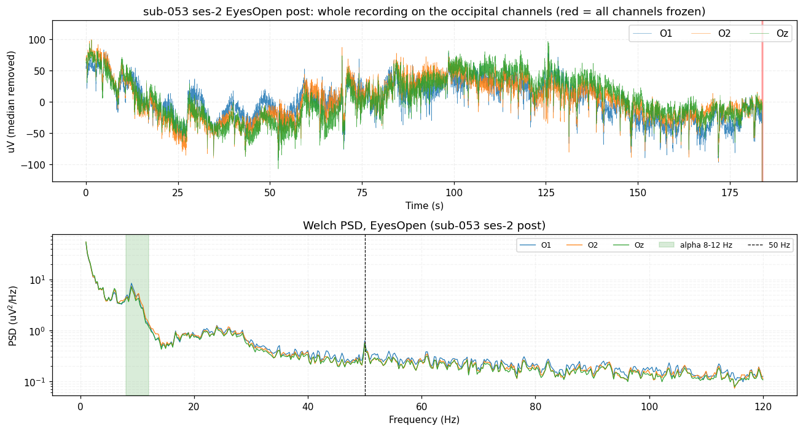

</details>
