# 🔍 sub-325: example output (a healthy subject)

The unmodified output of

```bash
python qc_eeg_subject.py 325
```

for `sub-325` of [OpenNeuro ds005385 v1.0.3](https://openneuro.org/datasets/ds005385/versions/1.0.3). This subject completed **session 1 only**, so four recordings were analysed (and 11 figures were drawn).
How to read each file: [output guide](../../docs/output-guide.md)  ·  back to the [main README](../../README.md)

## Result at a glance

| | |
|---|---|
| **QC verdict** | **PASS** |
| **Subject label** | `USABLE` |
| Recordings PASS / FLAG / FAIL | 4 / 0 / 0 |
| Usable recordings | **4 of 4** |
| Time for this subject (incl. download) | 58.0 s (HTTPS download) |

> overall PASS; USABLE: 4/4 recordings usable; no bad channels; alpha blocking OK (median 4.7)

| Session | Task | Acq | Verdict | Label | Bad channels | Which | Alpha EC/EO | 50 Hz (dB) |
|---|---|---|---|---|---:|---|---:|---:|
| ses-1 | EyesClosed | pre | PASS | `USABLE` | 0 | – | 4.53 | 2.41 |
| ses-1 | EyesClosed | post | PASS | `USABLE` | 0 | – | 4.85 | 3.56 |
| ses-1 | EyesOpen | pre | PASS | `USABLE` | 0 | – | 4.53 | 5.08 |
| ses-1 | EyesOpen | post | PASS | `USABLE` | 0 | – | 4.85 | 3.85 |

## Folder structure

```text
sub-325/
├── README.md                          (this file)
├── status.txt                         summary of the whole subject
├── status.json                        the same, machine-readable
└── qc_results/
    ├── df_recordings.csv              one row per recording
    ├── df_recordings_full.csv         every metric of every layer
    ├── df_subjects.csv                one row for the subject
    ├── df_channels.csv                one row per channel and recording
    ├── qc_issues.csv                  every FAIL / FLAG / MISSING finding
    ├── qc_signoff.csv                 sheet for the human reviewer
    ├── qc_pivot.csv                   verdict per recording in one row
    ├── qc_report.txt                  readable report
    ├── run_manifest.json              everything needed to reproduce the run
    ├── run_log.txt                    terminal text of this subject
    └── figures/
        ├── sub-325_task-rest_channel_quality_topomap.png
        ├── G_spatial_correlation_sub-325.png
        ├── A_psd_occipital_sub-325.png
        ├── B_amplitude_heatmap_sub-325.png
        ├── C_traces_sub-325.png
        ├── D_psd_all_channels_sub-325.png
        ├── E_scalp_3d_sub-325.png
        └── F_overview_sub-325_ses-1_<task>_<acq>.png    (4 files)
```

## Key files

| | |
|---|---|
| [`status.txt`](status.txt) | verdict, label, per-recording table, "needs attention" |
| [`qc_results/qc_report.txt`](qc_results/qc_report.txt) | readable report |
| [`qc_results/df_recordings.csv`](qc_results/df_recordings.csv) | one row per recording |
| [`qc_results/qc_issues.csv`](qc_results/qc_issues.csv) | all findings with reason codes (empty for a clean subject) |
| [`qc_results/df_channels.csv`](qc_results/df_channels.csv) | per-channel statistics and flags |
| [`qc_results/run_manifest.json`](qc_results/run_manifest.json) | reproducibility record |

## Figures

### Channel quality topomap
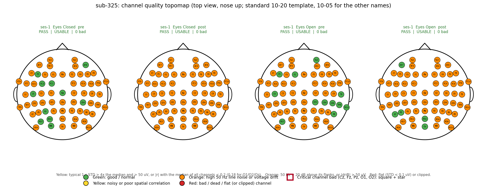

### Spatial correlation
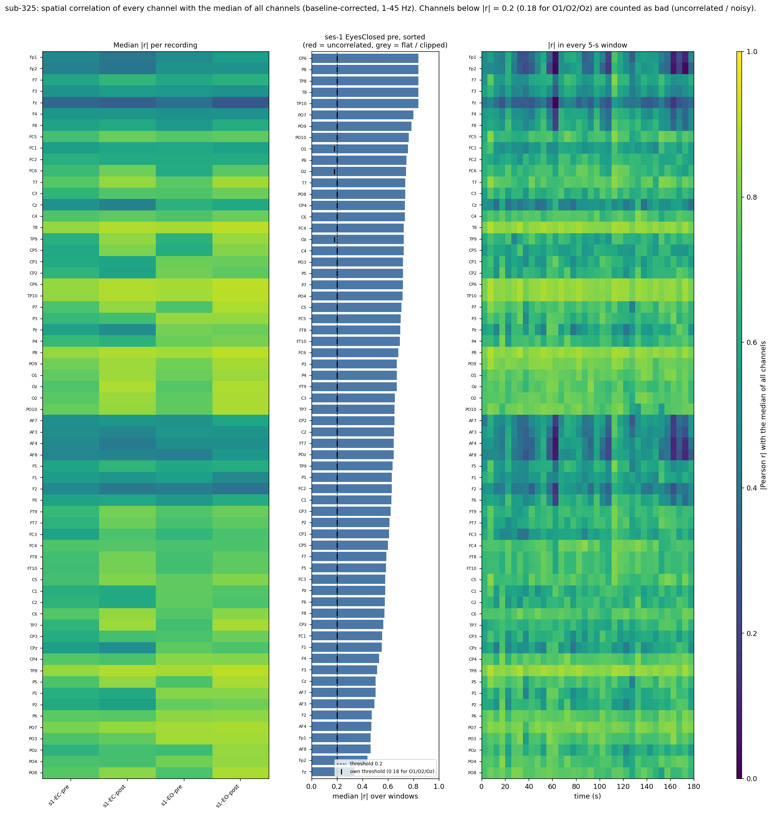

### Occipital spectrum (alpha and 50 Hz)
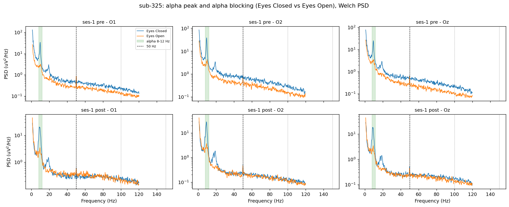

### Amplitude per channel and recording
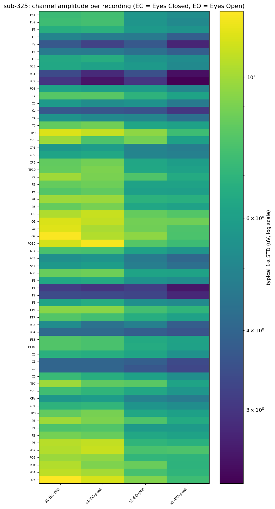

### Six seconds of EEG
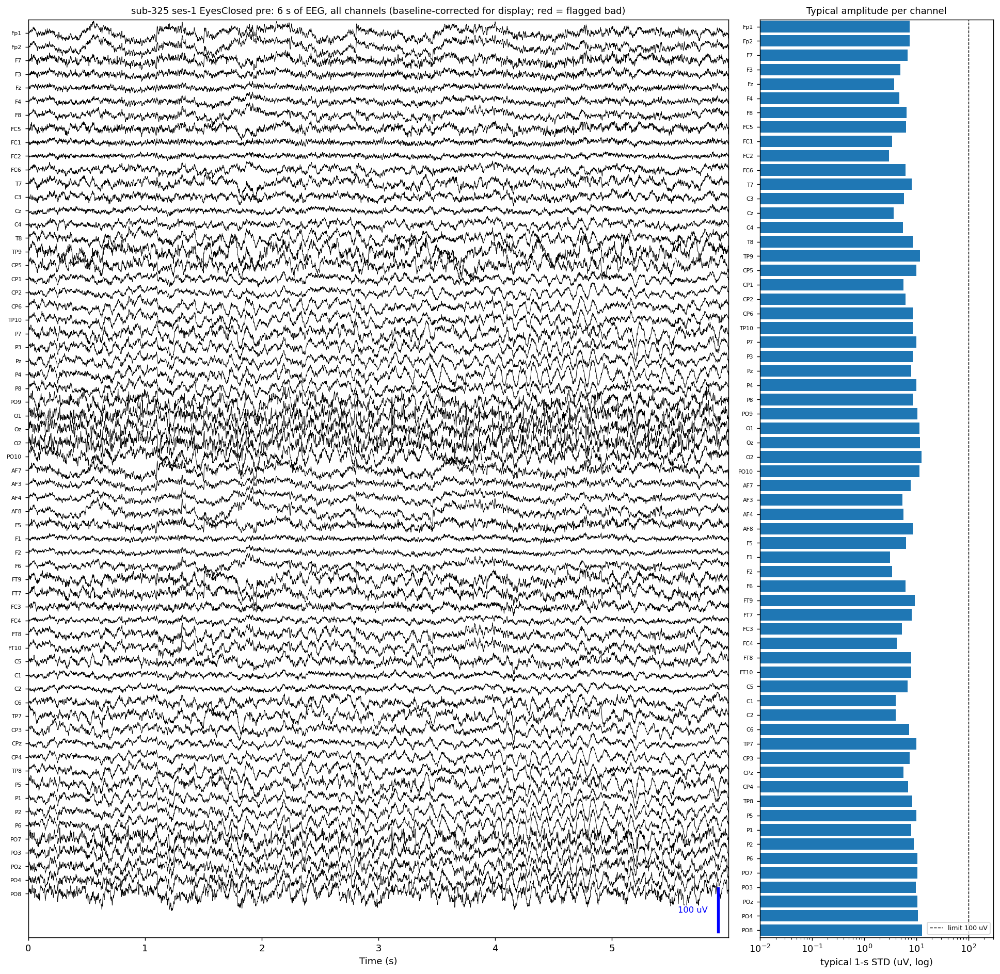

### Spectrum of all channels
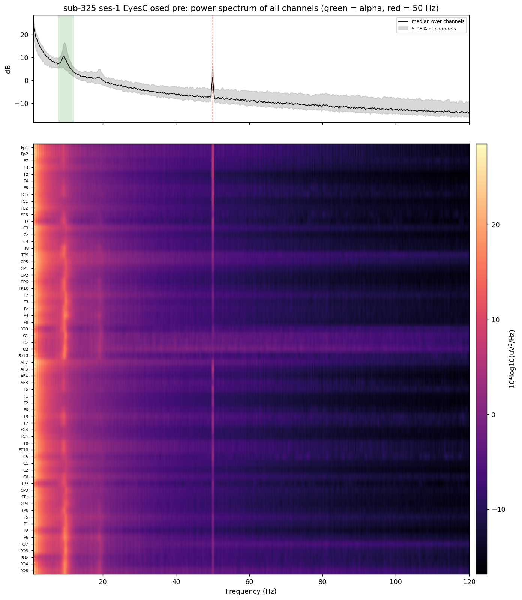

### 3D scalp maps
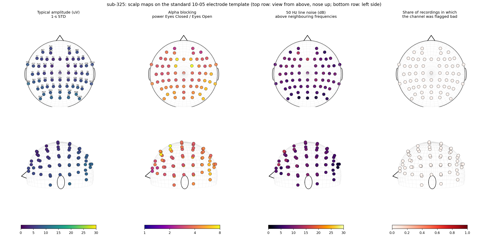

<details>
<summary><b>Whole-recording overviews (4 figures, one per recording)</b></summary>

**ses-1, Eyes Closed, pre**  
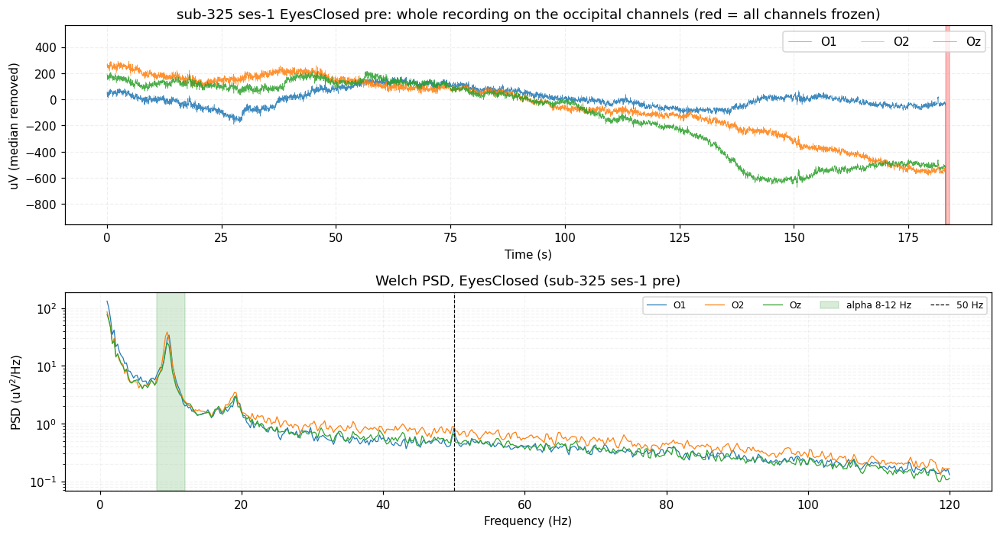

**ses-1, Eyes Closed, post**  
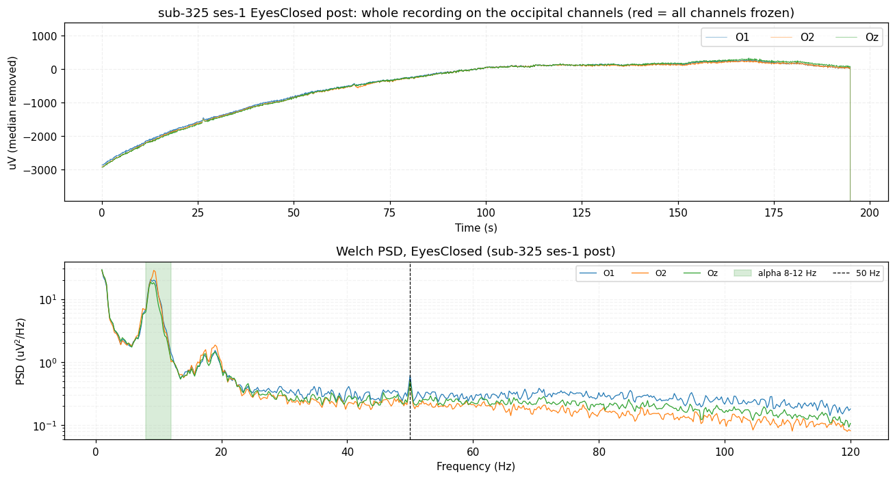

**ses-1, Eyes Open, pre**  
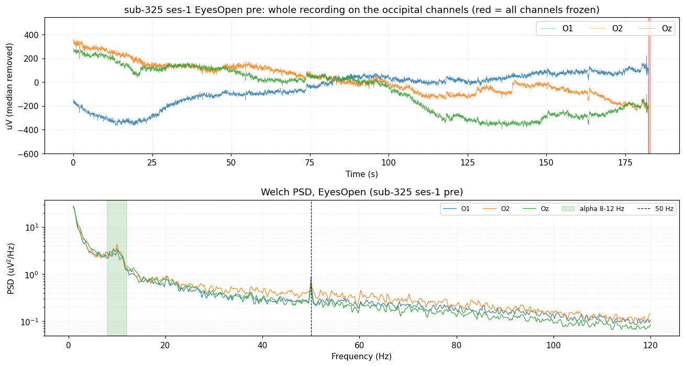

**ses-1, Eyes Open, post**  
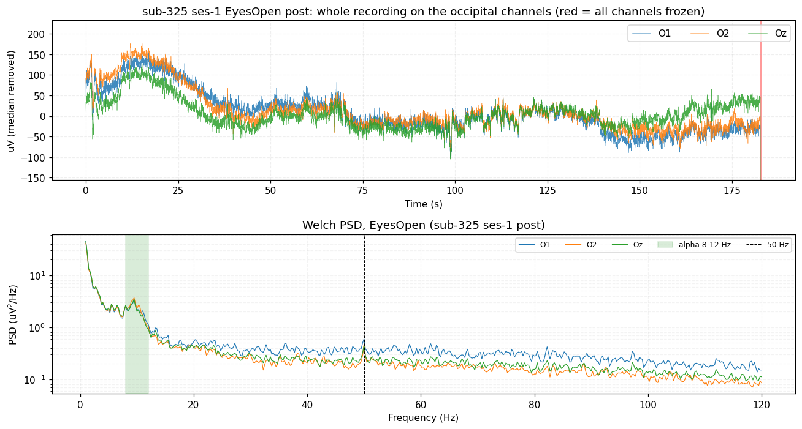

</details>